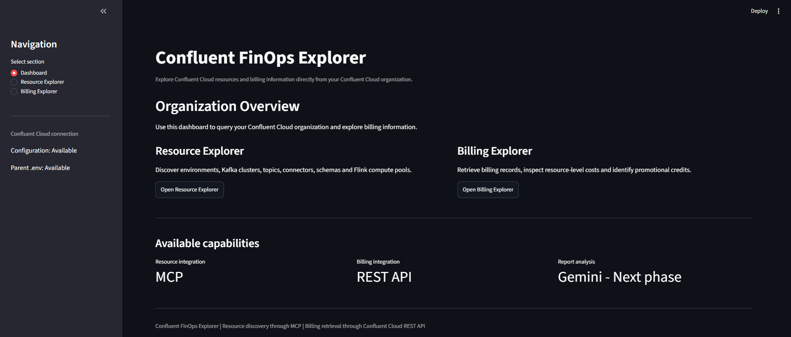
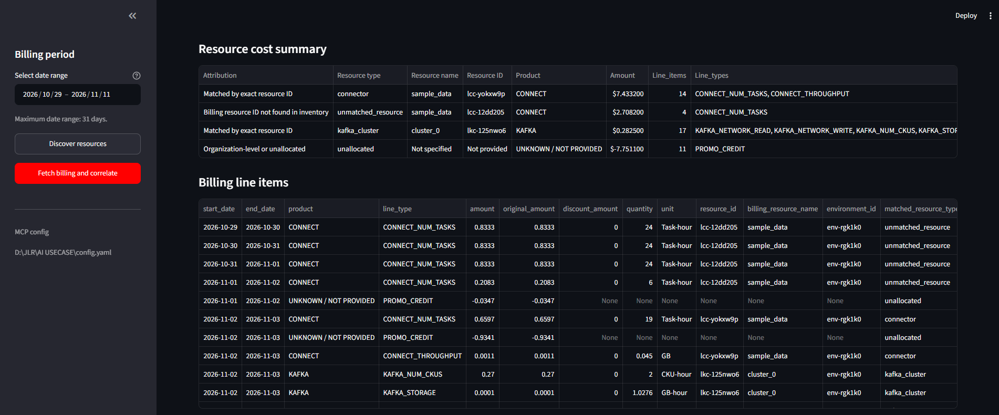
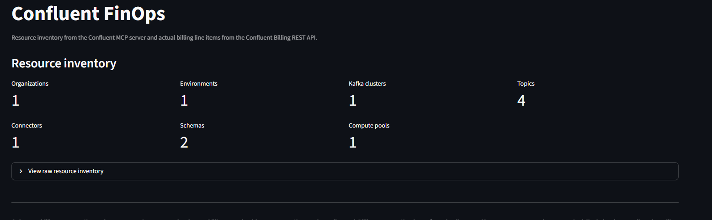

# Confluent FinOps Chatbot

A backend-connected chatbot for analysing Confluent Cloud expenditure
and resource inventory. It combines the Confluent Cloud Billing REST
API, the existing Confluent MCP server and Gemini 2.5 Flash for natural-language explanations.

The chatbot is a separate application. It does not modify or replace the
existing FinOps Explorer.

## Contents

-   [Overview](#overview)
-   [Architecture and request flow](#architecture-and-request-flow)
-   [Why billing is retrieved through the REST
    API](#why-billing-is-retrieved-through-the-rest-api)
-   [Billing date range and API
    limitations](#billing-date-range-and-api-limitations)
-   [Reconciliation approach](#reconciliation-approach)
-   [Project structure](#project-structure)
-   [Prerequisites](#prerequisites)
-   [Configuration](#configuration)
-   [Installation](#installation)
-   [Run the chatbot](#run-the-chatbot)
-   [Screenshots](#screenshots)
-   [Example questions](#example-questions)
-   [Current limitations](#current-limitations)
-   [Next steps](#next-steps)
-   [Troubleshooting](#troubleshooting)

## Overview

The chatbot answers FinOps questions using live billing data and the
current Confluent Cloud resource inventory.

### Main capabilities

-   Retrieve billing line items for a selected date range.
-   Retrieve Confluent Cloud inventory through the existing MCP server.
-   Summarise gross non-promotional expenditure, promotional credits,
    and net billing.
-   Group billing amounts by resource ID and product.
-   Reconcile billing resource IDs against the live inventory.
-   Retain unmatched or historical billing resource IDs instead of
    dropping them.
-   Explain results and provide recommendations using Gemini 2.5 Flash.
-   Retain local chat history under `data_store/chat_history/`.

No manual billing or inventory file upload is required. The backend
retrieves both data sources.

## Architecture and request flow

``` text
                         User
                          |
                          v
                Streamlit chatbot UI
                          |
                          v
                 Python backend
                    /        \
                   /          \
                  v            v
       Confluent Billing     Existing Confluent
          REST API             MCP server
              |                    |
              v                    v
       Billing line items     Resource inventory
              |                    |
              +---------+----------+
                        |
                        v
              Python FinOps engine
          - normalise billing rows
          - calculate gross expenditure
          - separate promotional credits
          - calculate net billing
          - group by resource ID
          - reconcile exact resource IDs
          - retain unmatched historical IDs
                        |
                        v
                FinOps result context
                        |
                        v
                 Gemini 2.5 Flash
          Natural-language explanation only
                        |
                        v
                  Chatbot response
```

### Responsibilities

  -----------------------------------------------------------------------
  Component                           Responsibility
  ----------------------------------- -----------------------------------
  Streamlit                           User interface, billing date
                                      selection, refresh action, chat
                                      interaction, tables and diagnostics

  Python backend                      API calls, MCP orchestration,
                                      parsing, calculations,
                                      reconciliation and chat context

  Confluent Billing REST API          Source of billing line items

  Confluent MCP server                Source of Confluent resource
                                      inventory

  Gemini 2.5 Flash                    Explain calculated results and
                                      answer questions using supplied
                                      FinOps context

  `data_store/chat_history/`          Local chat history
  -----------------------------------------------------------------------

**Important:** Financial totals and resource allocations are calculated
in Python. Gemini is not used as the source of financial figures and
must not invent costs or savings.

## Why billing is retrieved through the REST API

The chatbot retrieves billing from the Confluent Cloud Billing REST API:

``` text
https://api.confluent.cloud/billing/v1/costs
```

The request uses HTTP Basic Authentication with the Confluent Cloud API
key and secret.

Billing is retrieved directly from this endpoint rather than through MCP
because the billing endpoint provides the cost line-item data needed for
financial calculations, including amounts, products, line types,
quantities, units, and resource identifiers. The MCP server remains
responsible for resource inventory and operational metadata.

This separation gives the application two clear sources of truth:

-   **Billing API:** what was charged or credited.
-   **MCP inventory:** which resources currently exist and their
    configuration.

The chatbot does not rely on resource display names alone to reconcile
billing. Resource IDs are used wherever possible.

## Billing date range and API limitations

The Billing API accepts a `start_date` and an `end_date`:

-   `start_date` is inclusive.
-   `end_date` is exclusive.
-   A single request can cover a maximum of 31 days.
-   Results can be paginated.

The UI presents the selected start and end dates as inclusive dates. The
backend converts the selected end date to the following date when
calling the API, so the complete selected end date is included.

For example, selecting 20 October through 12 November results in API
windows that cover:

``` text
start_date = 2026-10-20
end_date   = 2026-11-13
```

The backend splits longer periods into consecutive requests of no more
than 31 days and follows pagination for each window. This is why the
application can retrieve a user-selected period longer than 31 days even
though an individual API request is limited to 31 days.

### Why the API cannot return an unrestricted date range in one request

The 31-day maximum is an API request constraint. It does not mean that
the chatbot can only analyse 31 days in total. The backend works around
the per-request limit by splitting the requested period into smaller
windows and combining the returned billing rows.

Billing data availability is also subject to Confluent's billing data
publication and retention behaviour. A date range being selectable does
not guarantee that every date has finalised billing data at the time of
retrieval. For recent dates, results may be provisional or incomplete
depending on when Confluent publishes the billing records.

For financial reporting, compare the selected period with the billing
data available in Confluent Cloud and allow for billing updates.

## Reconciliation approach

The application groups non-promotional billing rows by their resource ID
and compares those IDs with the inventory retrieved through MCP.

### Reconciliation rules

1.  Prefer an exact resource ID match.
2.  A previously verified resource-ID mapping may be used only while the
    corresponding resource is present in live inventory.
3.  A matching display name by itself is not sufficient proof of
    identity.
4.  Historical resource IDs remain in the report even if they are absent
    from current inventory.

### Current verified example

  -----------------------------------------------------------------------
  Resource ID             Resource name           Interpretation
  ----------------------- ----------------------- -----------------------
  `lkc-125nwo6`           `cluster_0`             Matched by exact
                                                  resource ID

  `lcc-yokxw9p`           `sample_data`           Matched using a
                                                  previously verified
                                                  resource-ID mapping
                                                  while the connector is
                                                  present in inventory

  `lcc-12dd205`           `sample_data`           Unmatched; potentially
                                                  historical. Retained in
                                                  billing totals
  -----------------------------------------------------------------------

The connector configuration returned by MCP provides the connector name
and configuration properties, but in the current response it does not
expose the `lcc-*` resource ID. The application therefore does not
derive a connector ID from its name.

## Project structure

Expected folder layout:

``` text
AI USECASE/
│
├── .env                         # Confluent API credentials
├── config.yaml                  # Confluent MCP configuration
│
├── finops-ai/                   
│   └── app.py
│
└── finops-chatbot/
    ├── chatbot_backend.py       # Streamlit application and backend
    ├── .env                     # Gemini configuration
    └── data_store/
        └── chat_history/        # Created automatically
```

The chatbot expects `config.yaml` and the parent `.env` one directory
above the chatbot project folder. Keep the existing FinOps Explorer and
its configuration in place.

## Prerequisites

-   Python 3.12 (or a compatible Python version supported by the
    installed dependencies).
-   Node.js and npm, because the backend launches the existing MCP
    package through `npx`.
-   Access to the Confluent Cloud organisation and the required API
    credentials.
-   A working existing Confluent MCP configuration.
-   A Google AI Studio API key for Gemini.
-   VS Code or another Python editor.

No Docker installation is required.

## Configuration

### 1. Parent `.env`

Keep the existing file at:

``` text
..\AI USECASE\.env
```

It must contain the Confluent Cloud API credentials:

``` dotenv
CONFLUENT_CLOUD_API_KEY=your_confluent_cloud_api_key
CONFLUENT_CLOUD_API_SECRET=your_confluent_cloud_api_secret
```

Do not commit this file or share its contents.

### 2. Existing MCP configuration

The existing MCP configuration must remain at:

``` text
..\AI USECASE\config.yaml
```

The chatbot launches the configured MCP server using this file. It does
not require a second MCP server configuration.


### 3. Chatbot `.env`

Create this file inside the chatbot project:

``` text
..\AI USECASE\finops-chatbot\.env
```

Add:

``` dotenv
GOOGLE_API_KEY=your_google_ai_studio_api_key
GEMINI_MODEL=gemini-2.5-flash
```

Optional backend settings:

``` dotenv
MCP_TIMEOUT_SECONDS=90
HTTP_TIMEOUT_SECONDS=30
CONFLUENT_BILLING_URL=https://api.confluent.cloud/billing/v1/costs
```

The backend loads the chatbot `.env` and the parent `.env`. Do not put
API secrets in source code.

## Installation

Open PowerShell and navigate to the chatbot folder:

``` powershell
cd "..\AI USECASE\finops-chatbot"
```

Create a virtual environment:

``` powershell
py -3.12 -m venv .venv
```

Activate it:

``` powershell
.\.venv\Scripts\Activate.ps1
```

Upgrade pip:

``` powershell
python -m pip install --upgrade pip
```

Install the Python dependencies used by the backend:

``` powershell
pip install -r requirements.txt
```

The MCP server package is launched through `npx` at runtime:

``` text
@confluentinc/mcp-confluent
```

Confirm Python and Node.js are available:

``` powershell
python --version
node --version
npm --version
npx --version
```

## Run the chatbot

From the activated virtual environment and the chatbot folder:

``` powershell
streamlit run chatbot_backend.py
```

Streamlit opens the application in the browser. If it does not open
automatically, use the local URL printed in the terminal, normally:

``` text
http://localhost:8501
```

### Typical usage

1.  Open the chatbot.
2.  Select the billing start date and end date in the sidebar.
3.  Select **Refresh backend data**.
4.  Confirm the billing connection status and MCP inventory status.
5.  Review the FinOps overview and resource cost breakdown.
6.  Inspect unmatched resource IDs and backend diagnostics.
7.  Ask a question in the chat interface.

The first refresh may take longer because the backend starts the MCP
server and retrieves inventory.

## Screenshots

Store screenshots in a `screenshots/` folder in the project root. Use
descriptive filenames so that the README remains easy to maintain.

Suggested layout:

``` text
finops-chatbot/
├── screenshots/
│   ├── ui-overview.png
│   ├── ui-resource-cost-breakdown.png
│   ├── prompt-01-expenditure.png
│   ├── prompt-02-resource-analysis.png
│   ├── prompt-03-billing-anomalies.png
│   ├── prompt-04-promo-credits.png
│   └── prompt-05-optimization.png
```

### UI pages

#### FinOps overview and resource cost breakdown

``` markdown

```

#### Additional UI views


``` markdown

```


``` markdown

```

### Prompt output screenshots


## Current limitations

### Billing API constraints

-   Each Billing API request is limited to 31 days; the backend splits
    longer selections into multiple requests.
-   Billing data for recent dates may not yet be final or complete.
-   API pagination must be completed to avoid omitting line items.

### Inventory and reconciliation constraints

-   MCP inventory represents resources currently discoverable through
    the configured connection. It is not a complete historical
    inventory.
-   A resource deleted from Confluent Cloud may still appear in billing
    for a selected period.
-   Unmatched billing resource IDs are retained and labelled; they
    should not be silently discarded or treated as zero cost.

### Cost attribution

-   Billing resource IDs are the basis for resource reconciliation.
-   A resource display name is not a unique identifier.

## Next steps

1.  **Improve historical resource mapping.** Persist a time-aware
    resource-ID history so deleted or renamed resources can be
    reconciled against billing periods in which they existed.
2.  **Add billing-period comparison.** Retrieve and compare two
    user-selected periods, including product and resource-level changes.
3.  **Add anomaly detection.** Flag large changes, unexpected product
    charges, unusual quantities, and newly appearing resource IDs using
    explicit thresholds.
4.  **Add cost trends.** Present daily or monthly trends where the
    Billing API granularity and returned data support them.
5.  **Add recommendation evidence.** For each optimization suggestion,
    show the billing rows, quantities, configuration or metric that
    supports it. Clearly separate measured facts from general advice.
6.  **Improve inventory diagnostics.** Show per-category counts, tool
    execution status, parsing status and timeout details.
7.  **Add automated tests.** Test date-window splitting, pagination,
    promo-credit handling, exact-ID reconciliation, historical IDs and
    malformed MCP responses.

## Troubleshooting

### Billing API authentication failure

-   Confirm `CONFLUENT_CLOUD_API_KEY` and `CONFLUENT_CLOUD_API_SECRET`
    are present in the parent `.env`.
-   Confirm the API key has permission to read billing data.
-   Do not paste credentials into the chatbot or source code.

### MCP configuration not found

Confirm that the following file exists:

``` text
..\AI USECASE\config.yaml
```

The chatbot expects this file one directory above `finops-chatbot`.

### MCP inventory returns zero records

Check the Backend diagnostics section. A successful MCP connection does
not necessarily mean every inventory response was parsed. The server can
return structured JSON, plain text or errors. Check each resource
category separately.


------------------------------------------------------------------------

## Security notes

-   Never commit `.env`, API keys, secrets or credential-bearing
    configuration.